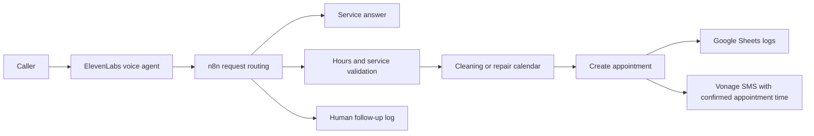

# Nile Auto — Bilingual AI Voice Receptionist

A bilingual (**English & Egyptian Arabic**) AI voice receptionist built for **Nile Auto** using **ElevenLabs**, **n8n**, **Google Calendar**, **Google Sheets**, and **Vonage SMS**. It answers customer service inquiries, validates business hours and service durations, checks real-time calendar availability, books appointments, and sends SMS confirmations.

## Architecture & Workflow

- **Bilingual Voice & LLM:** ElevenLabs handles real-time conversational audio in both English and Egyptian Arabic, powered by OpenRouter LLM routing.
- **Smart Scheduling & Conflict Protection:** Routes requests across separate Google Calendars for car cleaning and mechanical/battery repairs. Enforces Cairo timezone rules, business hours, Friday closures, service durations, and duplicate/conflict prevention before confirming any slot.
- **Automated CRM & Audit Logging:** Writes structured customer profiles, confirmed appointments, general inquiries, and human-escalation cases to separate Google Sheets tabs.
- **Instant SMS Confirmation & Human Handoff:** Once a calendar event is saved, Vonage sends an SMS confirmation with the booked date and time. Complex complaints or refund requests are logged directly for staff follow-up.

## End-to-End Verification

In end-to-end execution testing (including spoken Egyptian Arabic booking runs such as n8n Execution `#712`), the voice agent greeted the caller in Egyptian Arabic, checked cleaning calendar availability, created the confirmed one-hour Google Calendar event, logged the customer and appointment rows in Google Sheets, and delivered the confirmation SMS to the target phone.

## Setup & Configuration

The [`workflows/nile-auto-booking.json`](workflows/nile-auto-booking.json) file contains the 66-node n8n backend workflow with all private credentials, webhook paths, calendar IDs, spreadsheet IDs, and phone numbers sanitized. To run it in your own environment:

1. Import [`workflows/nile-auto-booking.json`](workflows/nile-auto-booking.json) into n8n.
2. Connect your **Google Calendar**, **Google Sheets**, and **Vonage** credentials and configure your calendar and sheet IDs.
3. Connect an **ElevenLabs Conversational AI** agent to the n8n webhook endpoints for availability checks and appointment booking.
