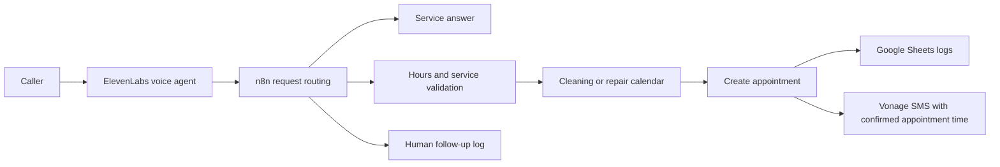

# Nile Auto AI Voice Receptionist

An AI-assisted voice receptionist demo for **Nile Auto**, a fictional car-care business in Cairo. It answers service questions in English or Egyptian Arabic, checks appointment availability, and handles booking requests through an n8n workflow. After a booking is created, it sends an SMS with the confirmed appointment date and time.

## How it works

- **Voice and language:** ElevenLabs handles the call; OpenRouter supplies the language model.
- **Scheduling:** Separate Google Calendars for cleaning and repairs. The booking flow checks business hours, service duration, Friday closure, and conflicts. It confirms a booking only after the calendar event is created.
- **Records:** Google Sheets stores customer and appointment records, including requests that need human follow-up.
- **Messages:** After the calendar event is created, Vonage sends an SMS with the confirmed appointment date and time. Complaints and refund issues go to a human follow-up log; the agent does not promise an automatic resolution.

## Demo evidence and scope

In a **user-reported spoken Egyptian Arabic demo**, the agent confirmed a cleaning appointment, n8n created the correct one-hour calendar event, the customer and appointment rows appeared in Google Sheets, and the confirmation SMS arrived on a test phone. This describes one controlled test. Saved n8n executions are visible for this workflow, including a successful run on 15 October 2026 at 14:51:15 (execution #712). The execution status supports that the workflow ran; the spoken interaction and SMS arrival on the test phone remain reported by the project owner rather than independently replayed here.

The demo used a restricted test number and a temporary webhook. It is **not a live customer booking service**. Built and tested with AI assistance.

## Workflow status

The [n8n workflow export](workflows/nile-auto-booking.json) is a sanitized review copy of the 66-node **Nile Auto — Safe Booking Draft (Vonage SMS)** workflow opened in n8n on 16 October 2026. Its calendar, Google Sheets, and Vonage paths are visible in the export. The ElevenLabs agent configuration and OpenRouter model settings are outside this n8n export.

Credential references, webhook path, calendar and spreadsheet IDs, email addresses, phone numbers, and n8n instance IDs have been removed from the public copy. It is inactive and **not ready to run** without your own configuration. The original live workflow was not changed or executed for this repository.
